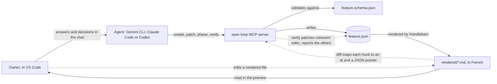
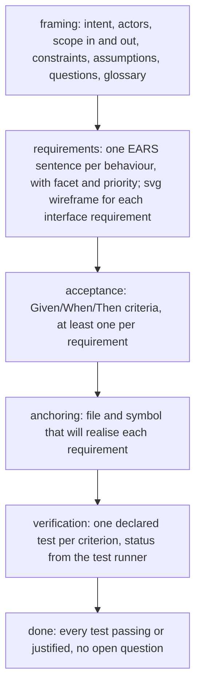

# spec-loop

spec-loop is for a product owner who works with a coding agent and wants to decide what gets built without writing specifications by hand. The agent keeps one JSON model per feature. A JSON Schema governs which fields each phase requires and when a phase may close. The model is rendered as French Markdown documents that the owner reads in the VS Code preview. The owner answers in the chat, or edits the documents directly and asks the agent to verify. The agent maps each edit back to the object it changes and applies it. It reports, and does not apply, any edit that widens the scope or contradicts the model. Everything goes through one MCP server, so it works the same with Gemini CLI, Claude Code and Codex.



A feature goes through six phases. Each phase adds one kind of object and is left only when the schema says it is complete:



## Day one

You need Node 22 or later, a project folder, VS Code 1.121 or later, and one agent. **The package `mcp-spec-loop` is not published on npm yet.** Until it is, clone this repository and run `npm install` in it (this builds `dist/`). Then replace `npx -y mcp-spec-loop@0.1.0` in the lines below with `node /path/to/spec-loop/dist/mcp.js`.

Every line is run from the project folder.

**Gemini CLI or Antigravity**

```sh
gemini mcp add -s project -e SPEC_LOOP_ROOT="$PWD" spec-loop -- npx -y mcp-spec-loop@0.1.0
mkdir -p .agents/skills && cp -R /path/to/spec-loop/skills/* .agents/skills/
```

Antigravity CLI (`agy`), which replaced Gemini CLI for free and Google One accounts in June 2026, imports the Gemini setup with `agy plugin import gemini`. Alternatively, commit `examples/consumer/.agents/mcp_config.json`.

**Claude Code**

```sh
claude mcp add --scope project spec-loop -- npx -y mcp-spec-loop@0.1.0
mkdir -p .agents/skills && cp -R /path/to/spec-loop/skills/* .agents/skills/ && mkdir -p .claude && ln -s ../.agents/skills .claude/skills
```

**Codex**

```sh
codex mcp add spec-loop --env SPEC_LOOP_ROOT="$PWD" -- npx -y mcp-spec-loop@0.1.0
mkdir -p .agents/skills && cp -R /path/to/spec-loop/skills/* .agents/skills/
```

`examples/consumer/` holds every file a project commits for the three agents. That includes `.vscode/extensions.json`, with the preview extensions described below.

Walkthrough: ask the agent to create a feature, and run the `framing` skill. Open `spec/README.md` in the preview (Ctrl+Shift+V, Cmd+Shift+V on macOS) and edit a rendered line. Ask the agent to verify your changes, then tell it to move to the next phase.

The server looks for `spec/` in the `root` argument of each tool call. Without one, it uses `SPEC_LOOP_ROOT`, then `CLAUDE_PROJECT_DIR` (set by Claude Code), then its working directory. A value still holding an unexpanded `${…}` is skipped. The skills always pass `root`, and `status` and `features` echo the resolved path.

## Tools

| Tool | Writes | What it does |
| --- | --- | --- |
| `learn` | no | Returns the method by topic; `phases` and `fields` are generated from the schema. |
| `features` | no | Lists every feature: id, phase, completeness, pending owner edits, last modification. |
| `status` | no | Reports one feature: completeness, unaddressed fields, pending edits, last verify, phase history, last backward move. |
| `validate` | no | Checks a feature or a candidate object against the schema and the coverage rules; every error has a JSON pointer. |
| `diff` | no | Compares the regenerated projection with the files on disk; maps each hunk to an id and a pointer; classifies alterations. |
| `create` | yes | Writes the skeleton of a new feature (next FEAT number) and renders it; needs an absolute `root`. |
| `render` | yes | Renders the feature deterministically; refuses while owner edits are unverified. |
| `patch` | yes | Applies an RFC 6902 JSON Patch, validates, writes, re-renders; `id`, `name`, `phase` and `lifecycle` are protected. |
| `phase` | yes | Advances to the next phase when the current one is complete; moves back to an earlier one on the owner's decision with a reason. |
| `verify` | yes | Applies the coherent owner edits, turns the others into open questions, restores the projection, records the verification. |

Read-only tools carry `readOnlyHint: true`. Every result carries the same JSON as text and as `structuredContent`.

## Skills

| Skill | When | What the agent does |
| --- | --- | --- |
| `framing` | first phase | Interviews the owner one question per field, each with a recommended answer, exploring the repository first. |
| `acceptance` | acceptance | Drafts Given/When/Then criteria per requirement and asks the owner only for business values. |
| `anchoring` | anchoring | Reads the target repository and anchors each requirement on a file and symbol, without writing code. |
| `verification` | verification | Declares the test of each criterion; runs only the named test files once and records the runner's result. |
| `done` | closing | Checks the closing gate and closes the feature on the owner's decision. |
| `verify` | any time | Reconciles the owner's edits: applies the coherent ones, reports the others with the reason. |

The requirements phase has no skill: the agent writes them in conversation, guided by `learn` topic `fields`.

## Rendered documents

Each feature lives in `spec/FEAT-nnn-<name>/`. Its `feature.json` is the model and `rendered/` holds the projection. `assets/` holds the svg wireframes, and `.manifest.json` the hash of everything the server last wrote. `spec/README.md` is the index of all features, with a menu by phase and a warning for any feature with pending owner edits.

| File | Content |
| --- | --- |
| `index.md` | Phase diagram, documents, artifacts, what is left to do (task list), questions, history; warnings when the phase waits for answers or tests fail |
| `cadrage.md` | Intent, context diagram, actors, scope, constraints, assumptions, open questions (« À trancher ») and answered ones (« Tranché »), glossary |
| `exigences.md` | Summary table (id, title, facet, priority, EARS form, origin), then one block per requirement with its wireframes |
| `criteres.md` | One rule per requirement, one Gherkin example per criterion (Soit, Quand, Alors) |
| `ancrage.md` | Anchors: file, symbol, kind of change, requirements realised |
| `verification.md` | Declared tests and the coverage table |
| `decisions.md` | Decisions, when there are any |

A document appears once its phase is reached. A document of a closed phase opens with a line pointing at the current one. Every document opens and closes with the same navigation, rendered by one partial from the schema's phase list:
- a breadcrumb back to the feature and to all features;
- the menu of the feature's documents in phase order;
- « Précédent » and « Suivant » links at the bottom.

The diff ignores the navigation.

The built-in VS Code preview renders CommonMark, tables and Mermaid. `.vscode/extensions.json` recommends three extensions, which VS Code proposes when the folder is first opened:

| Extension | Adds | Without it |
| --- | --- | --- |
| `yahyabatulu.vscode-markdown-alert` | callouts: open question `[!IMPORTANT]`, answered `[!NOTE]`, blocking state `[!WARNING]` | a blockquote whose first line names the kind |
| `bierner.markdown-checkbox` | checkboxes in « Reste à faire » and the question list | a list line starting with `[ ]` or `[x]` |
| `bierner.markdown-footnotes` | footnotes for a textual source of a requirement | a marker and a paragraph below the block |

No meaning is carried by colour, and no inline HTML is used. The only exception is the `<!-- id: … -->` and `<!-- ptr: … -->` comments that let the diff find the object behind each block. The rules are in `method/artifacts.md`.

## Principles

- **The JSON is the truth.** The documents are a projection of it; nothing in them exists only in Markdown.
- **The schema governs the lifecycle.** Phases, their order, required fields and coverage rules live in `schema/feature.schema.json`. The code names no phase and no facet.
- **The MCP server is the only writer of `spec/`.** Agents never edit those files with a file tool; a hand edit of `feature.json` is detected and must be verified.
- **Rendering is deterministic.** The same model gives the same bytes, so a diff against the disk shows exactly what the owner changed.
- **Owner edits are first-class.** They are never overwritten unread. Each one is applied, or reported with its reason and kept as an open question, and the owner's files are saved before any re-render.

## Further reading

- `docs/vocabulary-research.md`: why each term, the EARS and Gherkin choices, the glossary.
- `docs/integration-guide.md`: how Gemini CLI, Antigravity, Claude Code and Codex load the server and the skills.
- `method/`: the method served by `learn`. `method/index.md` maps each phase to its skill.

## Decisions

- 2026-10-14: The MCP server is the only interface; the planned `bin/spec-loop` CLI was dropped.
- 2026-10-14: Vocabulary follows `docs/vocabulary-research.md`: English keys, French documents, EARS requirements, Gherkin criteria, a 24-term glossary including « facet ».
- 2026-10-14: Phases are never mixed: the schema rejects a section of a later phase, except one already reached before a backward move.
- 2026-10-14: `patch` writes when no error is `invalid`; `incomplete` errors only say what the phase still needs.
- 2026-10-14: Questions carry a `recommendation`; an open question keeps any phase incomplete.
- 2026-10-14: Coverage rules live in `x-checks`, are switched on by `x-phases`, and may be declared as filters (requirement ↔ artifact).
- 2026-10-14: Leaving a phase evaluates the entry rules of the next one (`gate: entry`, and every rule of a phase that produces nothing). This fixed FEAT-001 entering `done` with 22 tests not passing.
- 2026-10-14: `phase` moves back only on the owner's decision with a French reason; later sections are kept and not rendered.
- 2026-10-14: Features are numbered `FEAT-001`, in folders `FEAT-001-<name>`; tools accept the id, the name or the folder.
- 2026-10-14: Every alteration (rendered file, svg, `feature.json`, missing or extra file) is pending until `verify` accounts for it.
- 2026-10-14: A hand-edited `feature.json` is accepted only with a recorded reason and with `phase`, `id`, `name`, `lifecycle` untouched; otherwise it is restored from `.spec-loop/feature.last.json`.
- 2026-10-14: Each point `verify` reports becomes an open question in the framing.
- 2026-10-14: `status.unaddressed` lists optional fields never set; an empty array counts as addressed.
- 2026-10-14: Every requirement has a `facet`; facet `interface` requires an svg screen wireframe before leaving the requirements phase.
- 2026-10-14: Requirements have an optional French `title`; the summary table links to VS Code heading slugs.
- 2026-10-14: A test name starts with the id of a criterion it verifies; a method other than `test` needs a `reason`.
- 2026-10-14: Artifacts render next to the first requirement or criterion they illustrate, otherwise in the framing document; `illustrates` takes any feature id.
- 2026-10-14: Templates target the VS Code preview: CommonMark plus tables, no inline HTML, id and ptr comments alone on their line, no meaning by colour.
- 2026-10-14: Three degradable preview extensions are accepted (callouts, checkboxes, footnotes); VS Code keeps the built-in preview to CommonMark (microsoft/vscode#245064).
- 2026-10-14: Every document carries the same navigation from one partial; the diff attributes it to no object.
- 2026-10-14: Rendered file names are French, as they are owner-facing.
- 2026-10-14: Tests use their own fixtures under `test/fixtures/`, never the live `spec/` folder.
- 2026-10-14: `.spec-loop/` is local state, ignored by git.
- 2026-10-14: The npm package is `mcp-spec-loop`, unscoped; the repository and product keep the name spec-loop.
- 2026-10-14: Dependencies: handlebars, ajv, ajv-formats, fast-json-patch, diff, @modelcontextprotocol/sdk and zod (required by the SDK).

## Development

```sh
npm install                          # builds dist/ through prepare
npm run typecheck
npx vitest run test/render.test.ts   # one file at a time
npm start                            # the MCP server on stdio
```
