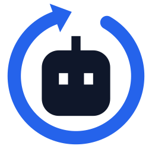
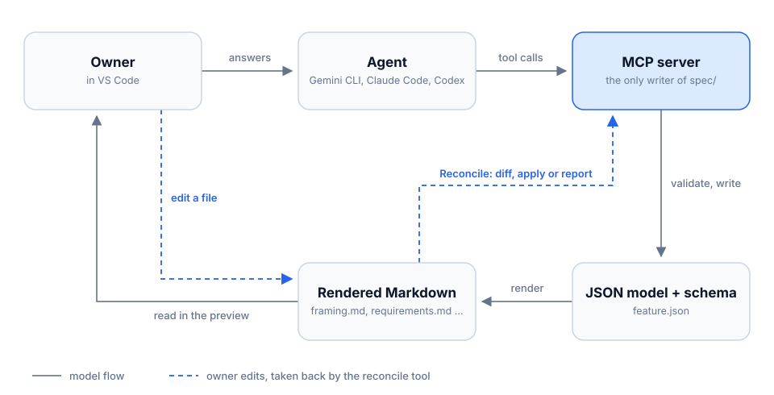
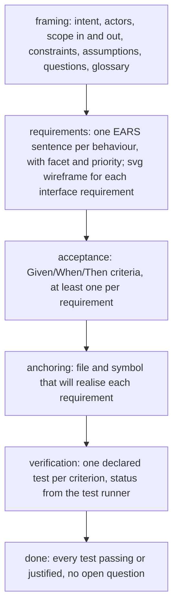

<div align="center">

<picture>
  <source media="(prefers-color-scheme: dark)" srcset="assets/brand/mark-dark.svg">
  
</picture>

# spec-loop

**Your coding agent keeps one JSON model per feature; you read and edit it as Markdown, and every edit comes back to it over MCP.**

<!-- npm: swap the static badge for https://img.shields.io/npm/v/mcp-spec-loop?labelColor=334155&color=2563eb once the package is published -->
<a href="https://www.npmjs.com/package/mcp-spec-loop"></a>


<a href="https://github.com/ng-galien/spec-loop/stargazers"></a>

</div>

spec-loop is for a product owner who works with a coding agent and wants to decide what gets built without writing specifications by hand.
The agent keeps the specification as data; you read it, answer, and edit it where you read it.

- **One JSON model per feature**, governed by a JSON Schema that says which fields each phase requires and when a phase may close.
- **Markdown documents** rendered from the model, read in the VS Code preview, that you can edit directly.
- **One MCP server** that takes your edits back into the model, so it works the same with Gemini CLI, Claude Code and Codex.

<picture>
  <source media="(prefers-color-scheme: dark)" srcset="assets/brand/loop-dark.svg">
  
</picture>

The model is rendered as Markdown documents that the owner reads in the VS Code preview. The owner answers in the chat, or edits the documents directly and asks the agent to take the edits into account. The agent maps each edit back to the object it changes and applies it. It reports, and does not apply, any edit that widens the scope or contradicts the model. spec-loop specifies; it does not implement: the code is written at the anchors, between the anchoring and verification phases, with the agent's usual development workflow.

A feature goes through six phases. Each phase adds one kind of object and is left only when the schema says it is complete:



## Contents

- [Why](#why)
- [Day one](#day-one)
- [Tools](#tools)
- [Skills](#skills)
- [Rendered documents](#rendered-documents)
- [Principles](#principles)
- [Further reading](#further-reading)
- [Development](#development)

## Why

- A coding agent works best on structured data, so the specification is a JSON model with a schema, not prose.
- The owner reads a projection of that model, as Markdown documents in the VS Code preview, and never edits JSON.
- The owner's answers and edits come back into the model through the MCP server: applied when coherent, reported with a reason otherwise.
- The schema fixes the granularity: six phases, each adding one kind of object, each closed only when complete.
- One server, one model, one set of skills: the same loop with Gemini CLI, Antigravity, Claude Code and Codex.

## Day one

You need Node 22 or later, a project folder, VS Code 1.121 or later, and one agent. Run every line from the project folder.

> [!NOTE]
> **The package `mcp-spec-loop` is not published on npm yet.** Until it is, clone this repository, run `npm install` in it (this builds `dist/`), and use the "until published" line of your agent.

### Gemini CLI

```sh
# once published
gemini mcp add -s project -e SPEC_LOOP_ROOT="$PWD" spec-loop -- npx -y mcp-spec-loop@0.1.0
# until published (local clone)
gemini mcp add -s project -e SPEC_LOOP_ROOT="$PWD" spec-loop -- node /path/to/spec-loop/dist/mcp.js
```

### Antigravity CLI

Run `agy plugin import gemini` after the Gemini line, or commit `examples/consumer/.agents/mcp_config.json`. Until the package is published, put the local command in `mcp_config.json`. Antigravity CLI (`agy`) replaced Gemini CLI for free and Google One accounts in June 2026.

### Claude Code

```sh
# once published
claude mcp add --scope project spec-loop -- npx -y mcp-spec-loop@0.1.0
# until published (local clone)
claude mcp add --scope project spec-loop -- node /path/to/spec-loop/dist/mcp.js
```

### Codex

```sh
# once published
codex mcp add spec-loop --env SPEC_LOOP_ROOT="$PWD" -- npx -y mcp-spec-loop@0.1.0
# until published (local clone)
codex mcp add spec-loop --env SPEC_LOOP_ROOT="$PWD" -- node /path/to/spec-loop/dist/mcp.js
```

### Enrich the loop from your project

A project can add to the base loop, never remove from it, with one file it owns: `spec/spec-loop.json`, validated by [`schema/project.schema.json`](schema/project.schema.json).

```json
{
  "hooks": [
    { "phase": "verification", "on": "beforeLeave", "run": "npm test", "timeout": 300, "title": "Unit tests" }
  ],
  "instructions": {
    "requirements": { "beforeLeave": "Check every interface requirement against docs/ui.md." }
  }
}
```

- A `beforeLeave` hook runs before `phase` moves the feature forward out of its phase; a non-zero exit blocks the move.
- An `onEnter` hook runs right after the phase is entered; a failure is recorded and does not undo the move.
- The server runs each command through the shell from the project root, with a timeout (120 s by default), and keeps the last 4000 characters of its output.
- Every run is recorded in the feature (`lifecycle.hookRuns`), shown by `status`, and listed in `rendered/verification.md`.
- `instructions` are appended to the schema's instructions in `next.instruction`.

The commands come only from this file, which belongs to the project like its `package.json` scripts; spec-loop runs nothing from a remote source. A complete example is in [`examples/consumer/spec/spec-loop.json`](examples/consumer/spec/spec-loop.json); the details are in `learn` topic `project`.

## Skills

Gemini CLI, Antigravity and Codex read `.agents/skills/`; Claude Code reads `.claude/skills/`, linked to the same folder:

```sh
mkdir -p .agents/skills && cp -R /path/to/spec-loop/skills/* .agents/skills/
mkdir -p .claude && ln -s ../.agents/skills .claude/skills   # Claude Code only
```

`examples/consumer/` holds every file a project commits for the three agents.

### Walkthrough

1. Ask the agent to create a feature, then run the `framing` skill.
2. Open `spec/README.md` in the preview (Ctrl+Shift+V, Cmd+Shift+V on macOS) and edit a rendered line.
3. Ask the agent to take your changes into account (`reconcile`), then tell it to move to the next phase.

The server looks for `spec/` in the `root` argument of each tool call. Without one, it uses `SPEC_LOOP_ROOT`, then `CLAUDE_PROJECT_DIR` (set by Claude Code), then its working directory. A value still holding an unexpanded `${…}` is skipped. The skills always pass `root`, and `status` and `features` echo the resolved path.

### VS Code

Commit `.vscode/extensions.json` from `examples/consumer/`. VS Code then proposes three preview extensions when the folder is first opened. Each one is optional, and the documents stay readable without it:

| Extension | Adds | Without it |
| --- | --- | --- |
| `yahyabatulu.vscode-markdown-alert` | callouts: open question `[!IMPORTANT]`, answered `[!NOTE]`, blocking state `[!WARNING]` | a blockquote whose first line names the kind |
| `bierner.markdown-checkbox` | checkboxes in "Left to do" and the question list | a list line starting with `[ ]` or `[x]` |
| `bierner.markdown-footnotes` | footnotes for a textual source of a requirement | a marker and a paragraph below the block |

## Tools

| Tool | Writes | What it does |
| --- | --- | --- |
| `learn` | no | Returns the method by topic; `phases` and `fields` are generated from the schema. |
| `features` | no | Lists every feature: id, phase, completeness, pending owner edits, last modification. |
| `status` | no | Reports one feature: file path, completeness, unaddressed fields, pending edits, last reconciliation, phase history, last backward move. |
| `validate` | no | Checks a feature or a candidate object against the schema and the coverage rules, parses every Mermaid artifact and, for a stored feature, checks every svg file; every error has a JSON pointer. |
| `diff` | no | Compares the regenerated projection with the files on disk; maps each hunk to an id and a pointer; classifies alterations. |
| `create` | yes | Writes the skeleton of a new feature (next FEAT number) and renders it; needs an absolute `root`. One feature at a time: refuses while another feature is not done, unless the owner asks for it (`by: "owner"` and a `reason`, recorded in the new feature). |
| `render` | yes | Renders the feature deterministically; refuses while owner edits are unverified. |
| `patch` | yes | Applies an RFC 6902 JSON Patch, validates, writes, re-renders; `id`, `name`, `phase` and `lifecycle` are protected. |
| `phase` | yes | Advances to the next phase when the current one is complete and the project's `beforeLeave` hooks pass; moves back to an earlier one on the owner's decision with a reason. Runs the `onEnter` hooks of the phase entered. |
| `reconcile` | yes | Applies the coherent owner edits, turns the others into open questions, restores the projection, records the reconciliation. |

Read-only tools carry `readOnlyHint: true`. Every result carries the same JSON as text and as `structuredContent`.

Every result about a feature (`create`, `status`, `patch`, `phase`, `reconcile`, and each line of `features`) carries `next`: the current `phase`, the `skill` to run, the `instruction` to follow now (from the schema: on entering the phase, while it is incomplete, before leaving it), the `missing` count and the `todo` list. The agent follows it at every turn, so the method is never more than one result away.

## Skills

| Skill | When | What the agent does |
| --- | --- | --- |
| `framing` | framing | Interviews the owner one question per field, each with a recommended answer, exploring the repository first. |
| `requirements` | requirements | Writes one EARS sentence per behaviour with facet, priority, title, rationale and source; a screen wireframe for each interface requirement. |
| `acceptance` | acceptance | Drafts Given/When/Then criteria per requirement and asks the owner only for business values. |
| `anchoring` | anchoring | Reads the target repository and anchors each requirement on a file and symbol, without writing code. |
| `verification` | verification | Declares the test of each criterion, writes a missing one at its declared place, runs only the named test files once and records the runner's result. |
| `done` | closing | Checks the closing gate and closes the feature on the owner's decision. |
| `reconcile` | any time | Takes the owner's edits into account: applies the coherent ones, reports the others with the reason. |

Between `anchoring` and `verification`, the agent implements at the anchors with its usual development workflow; spec-loop does not write code. Every phase skill reads the model at `status.file`, changes it only with `patch`, and follows the refusal rule of `method/loop.md`.

## Rendered documents

Each feature lives in `spec/FEAT-nnn-<name>/`. Its `feature.json` is the model and `rendered/` holds the projection. `assets/` holds the svg wireframes, and `.manifest.json` the hash of everything the server last wrote. `spec/README.md` is the index of all features, with a menu by phase and a warning for any feature with pending owner edits.

| File | Content |
| --- | --- |
| `index.md` | Phase diagram, documents, artifacts, what is left to do (task list), questions, history; warnings when the phase waits for answers or tests fail |
| `framing.md` | Intent, context diagram, actors, scope, constraints, assumptions, open questions and answered questions, glossary |
| `requirements.md` | Summary table (id, title, facet, priority, EARS form, origin), then one block per requirement with its wireframes |
| `criteria.md` | One rule per requirement, one Gherkin example per criterion (Given, When, Then) |
| `anchors.md` | Anchors: file, symbol, kind of change, requirements realised |
| `verification.md` | Declared tests and the coverage table |
| `decisions.md` | Decisions, when there are any |

A document appears once its phase is reached. A document of a closed phase opens with a line pointing at the current one. Every document opens and closes with the same navigation, rendered by one partial from the schema's phase list:

- a breadcrumb back to the feature and to all features;
- the menu of the feature's documents in phase order;
- "Previous" and "Next" links at the bottom.

The diff ignores the navigation.

The built-in VS Code preview renders CommonMark, tables and Mermaid; callouts, checkboxes and footnotes need the extensions listed under [VS Code](#vs-code), and read as plain blockquotes, list lines and paragraphs without them.

No meaning is carried by colour, and no inline HTML is used. The only exception is the `<!-- id: … -->` and `<!-- ptr: … -->` comments that let the diff find the object behind each block. The rules are in `method/artifacts.md`.

## Principles

- **The JSON is the truth.** The documents are a projection of it; nothing in them exists only in Markdown.
- **The schema governs the lifecycle.** Phases, their order, required fields and coverage rules live in `schema/feature.schema.json`. The code names no phase and no facet.
- **The MCP server is the only writer of `spec/`.** Agents never edit those files with a file tool; a hand edit of `feature.json` is detected and must be reconciled.
- **Rendering is deterministic.** The same model gives the same bytes, so a diff against the disk shows exactly what the owner changed.
- **Owner edits are first-class.** They are never overwritten unread. Each one is applied, or reported with its reason and kept as an open question, and the owner's files are saved before any re-render.

## Further reading

- [`docs/vocabulary-research.md`](docs/vocabulary-research.md): why each term, the EARS and Gherkin choices, the glossary.
- [`docs/integration-guide.md`](docs/integration-guide.md): how Gemini CLI, Antigravity, Claude Code and Codex load the server and the skills.
- [`method/`](method/index.md): the method served by `learn`. `method/index.md` maps each phase to its skill.
- [`docs/decisions.md`](docs/decisions.md): every decision, one dated line each.
- [`site/index.html`](site/index.html), published at https://ng-galien.github.io/spec-loop/: the project page; the brand is in [`assets/brand/`](assets/brand/brand.md).

## Development

```sh
npm install                          # builds dist/ through prepare
npm run build                        # assembles the skills, then compiles
npm run typecheck
npx vitest run test/render.test.ts   # one file at a time
npm start                            # the MCP server on stdio
```

The skills are generated. Edit `skills-src/`, never `skills/`:
- the shared parts are in `skills-src/parts/` (preamble, model, refusal, report, stop);
- each skill has a `skill.yaml` (name, description, phase, the parts in order, the patch example) and a `body.md` that places each part with `{{> part}}`.

Then run `npm run assemble`. It writes `skills/<name>/SKILL.md` and the copy in `examples/consumer/.agents/skills/`; the Gemini extension and the Claude and Codex plugins read `skills/` directly. `test/skills.test.ts` fails, and lists the stale files, when a generated skill differs from its source.

---

<div align="center">

<picture>
  <source media="(prefers-color-scheme: dark)" srcset="assets/brand/mark-dark.svg">
  
</picture>

Made for product owners who build with agents · [Project page](https://ng-galien.github.io/spec-loop/) · MIT licence

</div>
