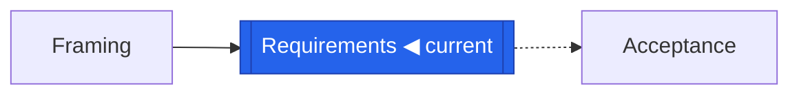
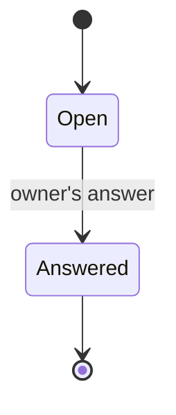

# Rendering probe for the VS Code Markdown preview

Open this file in the preview (Ctrl+Shift+V, or Cmd+Shift+V on a Mac) and note, for each section, whether it renders as described.

## 1. GitHub callouts

Extension needed: `yahyabatulu.vscode-markdown-alert`. Without it, each block stays a readable blockquote.

> [!NOTE]
> A note: if you see a box with an icon and the word "Note", callouts are rendered.

> [!WARNING]
> A warning: same test, in the warning colour.

> [!IMPORTANT]
> An important point.

Otherwise the three blocks above show as ordinary blockquotes starting with `[!NOTE]`.

## 2. Collapsible section

No extension; spec-loop does not use this construct.

Click to expand: five answered questions

If this text is hidden behind a clickable title, collapsible sections are rendered.

## 3. Checkboxes

Extension needed: `bierner.markdown-checkbox`. Without it, `[ ]` and `[x]` stay readable at the start of the line.

- [x] Question Q-01 answered
- [ ] Question Q-06 open

If you see boxes, one checked and one empty, task lists are rendered. Otherwise you see `[x]` and `[ ]` as text.

## 4. Table

No extension: rendered by the bare preview.

| Requirement | Priority | EARS pattern |
| --- | --- | --- |
| REQ-001 | MUST | ubiquitous |
| REQ-002 | SHOULD | event-driven |

## 5. Strikethrough, code, blockquote

No extension: rendered by the bare preview.

A ~~struck~~ word, an `identifier`, and a blockquote:

> The known revision protects against lost updates.

## 6. Footnote

Extension needed: `bierner.markdown-footnotes`. Without it, the marker and the note stay readable as text.

A claim with its source[^1].

[^1]: If this marker is clickable and the note appears at the bottom, footnotes are rendered.

## 7. Inline HTML

No extension; spec-loop uses no inline HTML.

Text red and bold by HTML style, a <mark>highlight</mark>, and a <kbd>Ctrl</kbd>.

If the text is neither red nor bold, HTML styles are stripped. If the highlight and the key show, those tags pass.

## 8. Mermaid with colours and shapes

No extension: Mermaid is built into VS Code since version 1.121; spec-loop uses no `classDef` in its generated diagrams.

Three possible outcomes: the "Requirements" node is blue (classDef colours pass), or it has the double-border shape without colour (only the shape passes), or the block shows as text (Mermaid not rendered).

## 9. Mermaid: sequence and states

No extension: Mermaid is built into VS Code since version 1.121.

## 10. Emoji and symbols

No extension; spec-loop only uses Unicode symbols (● ○ ◐ ◀), no emoji codes.

Unicode symbols: ✔ ✖ ▶ ◀ ⚠ ● ○ — and an emoji by code `:warning:` (rendered only if emoji codes are interpreted).

## 11. Local SVG image

A broken image here is expected: the file does not exist. This test only shows whether a local image by relative path is attempted.
