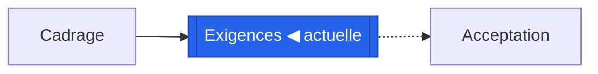
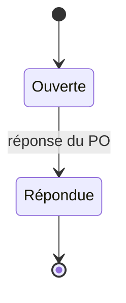

# Sonde de rendu pour l'aperçu Markdown de VS Code

Ouvrez ce fichier en aperçu (Ctrl+Maj+V, ou Cmd+Maj+V sur Mac) et notez, pour chaque section, si elle se rend comme décrit.

## 1. Callouts GitHub

Extension nécessaire : `yahyabatulu.vscode-markdown-alert`. Sans elle, chaque bloc reste une citation lisible.

> [!NOTE]
> Une note : si vous voyez un encadré avec une icône et le mot « Note », les callouts sont rendus.

> [!WARNING]
> Un avertissement : même test, en couleur d'alerte.

> [!IMPORTANT]
> Un point important.

Sinon, les trois blocs ci-dessus apparaissent comme des citations ordinaires commençant par `[!NOTE]`.

## 2. Section repliable

Aucune extension ; spec-loop n'utilise pas cette construction.

Cliquez pour déplier : cinq questions tranchées

Si ce texte est caché derrière un titre cliquable, les sections repliables sont rendues.

## 3. Cases à cocher

Extension nécessaire : `bierner.markdown-checkbox`. Sans elle, `[ ]` et `[x]` restent lisibles en début de ligne.

- [x] Question Q-01 répondue
- [ ] Question Q-06 ouverte

Si vous voyez des cases, cochée et vide, les listes de tâches sont rendues. Sinon vous voyez `[x]` et `[ ]` en texte.

## 4. Tableau

Aucune extension : rendu par l'aperçu de base.

| Exigence | Priorité | Forme |
| --- | --- | --- |
| REQ-001 | MUST | permanente |
| REQ-002 | SHOULD | sur événement |

## 5. Texte barré, code, citation

Aucune extension : rendu par l'aperçu de base.

Un mot ~~barré~~, un `identifiant`, et une citation :

> La révision connue protège contre la perte de mise à jour.

## 6. Note de bas de page

Extension nécessaire : `bierner.markdown-footnotes`. Sans elle, le renvoi et la note restent lisibles en texte.

Une affirmation avec sa source[^1].

[^1]: Si ce renvoi est cliquable et la note apparaît en bas, les notes de bas de page sont rendues.

## 7. HTML en ligne

Aucune extension ; spec-loop n'utilise pas de HTML en ligne.

Texte rouge et gras par style HTML, et un <mark>surlignage</mark>, et un <kbd>Ctrl</kbd>.

Si le texte n'est ni rouge ni gras, les styles HTML sont retirés. Si le surlignage et la touche s'affichent, ces balises passent.

## 8. Mermaid avec couleurs et formes

Aucune extension : Mermaid est intégré à VS Code depuis la version 1.121 ; spec-loop n'utilise pas `classDef` dans ses diagrammes générés.

Trois cas possibles : le nœud « Exigences » est bleu (les couleurs classDef passent), ou il a la forme à double bord sans couleur (seule la forme passe), ou le bloc apparaît en texte (Mermaid non rendu).

## 9. Mermaid : séquence et états

Aucune extension : Mermaid est intégré à VS Code depuis la version 1.121.

## 10. Emoji et symboles

Aucune extension ; spec-loop n'utilise que des symboles Unicode (● ○ ◐ ◀), pas de codes emoji.

Symboles Unicode : ✔ ✖ ▶ ◀ ⚠ ● ○ — et un emoji par code `:warning:` (rendu seulement si les codes emoji sont interprétés).

## 11. Image SVG locale

Une image cassée ici est normale : le fichier n'existe pas. Ce test ne sert qu'à voir si une image locale par chemin relatif est tentée.
