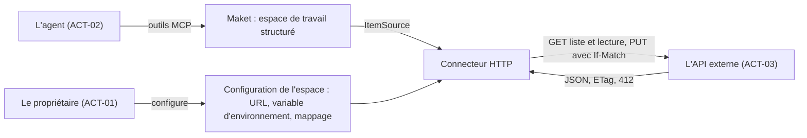
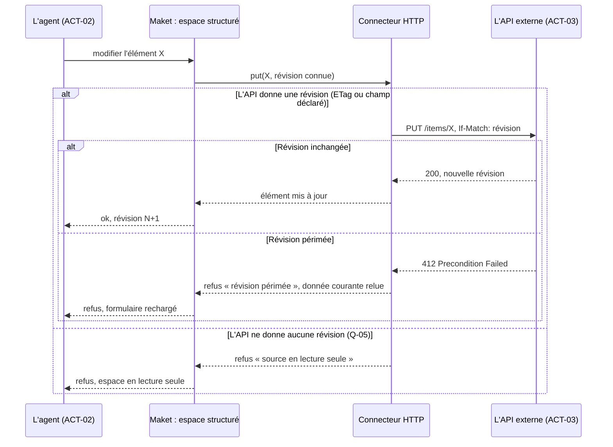

<!-- source: "/framing" template: "templates/framing.hbs" -->

_Document de la phase Cadrage, close ; la phase actuelle est Exigences : [exigences.md](exigences.md)._

# Cadrage : Connecteur HTTP pour les espaces structurés de Maket

<!-- ptr: /framing/intent -->
## Intention

Maket est un outil de documents visuels pour agents IA. Ses espaces de travail structurés listent des éléments venus d'une source de données, derrière l'interface ItemSource : liste par curseur, recherche, lecture, création, écriture, suppression, identité déclarée dans le schéma, révision pour détecter les conflits. Aujourd'hui, brancher une API REST demande du code propre à cette API. Le résultat voulu : un connecteur HTTP qui implémente ItemSource au-dessus d'une API REST décrite par configuration, pour qu'un espace de travail lise et écrive les éléments de cette API.

<!-- id: ART-01 -->
**Contexte du connecteur HTTP** (`ART-01`, contexte)

<!-- id: ART-02 -->
**Écriture d'un élément : révision, conflit et lecture seule** (`ART-02`, séquence)

<!-- ptr: /framing/actors -->
## Acteurs

<!-- id: ACT-01 -->
### Le propriétaire (`ACT-01`)

Choisit les API à brancher, fournit l'URL de base et le nom de la variable d'environnement qui porte le secret, lit les espaces de travail qui en résultent.

<!-- id: ACT-02 -->
### L'agent qui compose les espaces de travail (`ACT-02`)

Déclare un espace structuré branché sur le connecteur, puis liste, cherche, lit et modifie les éléments par les outils MCP de Maket.

<!-- id: ACT-03 -->
### L'API externe (`ACT-03`)

Service REST tiers qui détient les éléments. Elle fait foi sur leur contenu et sur leur révision.

## Périmètre

<!-- ptr: /framing/scope/in -->
### Dans le périmètre

<!-- ptr: /framing/scope/in/0 -->
- Lister les éléments par curseur, avec les paramètres de pagination et de recherche propres à l'API.
<!-- ptr: /framing/scope/in/1 -->
- Lire un élément par son identité.
<!-- ptr: /framing/scope/in/2 -->
- Écrire un élément par PUT avec l'en-tête If-Match portant la révision connue ; une réponse 412 est rendue à l'agent comme une révision périmée.
<!-- ptr: /framing/scope/in/3 -->
- Identité et révision des éléments déclarées dans le schéma de l'espace : champ d'identité, source de la révision (ETag ou champ de la réponse).
<!-- ptr: /framing/scope/in/4 -->
- Authentification par un secret lu dans une variable d'environnement dont seul le nom figure dans la configuration.
<!-- ptr: /framing/scope/in/5 -->
- Espace en lecture seule quand l'API n'offre pas d'écriture : le connecteur refuse alors toute écriture.
<!-- ptr: /framing/scope/in/6 -->
- En option, détection des changements faits hors de Maket, par webhook ou par interrogation périodique.

<!-- ptr: /framing/scope/out -->
### Hors périmètre

<!-- ptr: /framing/scope/out/0 -->
- Authentification OAuth interactive et rafraîchissement de jetons.
<!-- ptr: /framing/scope/out/1 -->
- API qui ne sont pas REST : GraphQL, SOAP, gRPC.
<!-- ptr: /framing/scope/out/2 -->
- Transformation métier des données au-delà du mappage déclaratif des champs.
<!-- ptr: /framing/scope/out/3 -->
- Fusion automatique des conflits : un conflit est signalé à l'agent, jamais résolu à sa place.

<!-- ptr: /framing/constraints -->
## Contraintes

<!-- id: CON-01 -->
- **CON-01** · Le connecteur implémente l'interface ItemSource existante sans la modifier.
<!-- id: CON-02 -->
- **CON-02** · Aucun secret n'est écrit dans le schéma, la configuration ou les documents : seulement le nom de la variable d'environnement.
<!-- id: CON-03 -->
- **CON-03** · Une écriture sans révision connue est refusée : aucun écrasement à l'aveugle.
<!-- id: CON-04 -->
- **CON-04** · Une erreur HTTP est rendue à l'agent avec son statut et le message de l'API ; une écriture n'est jamais réessayée en silence.

<!-- ptr: /framing/assumptions -->
## Hypothèses

<!-- id: ASM-01 -->
- **ASM-01** · Les API visées renvoient du JSON et exposent une identité stable par élément.
<!-- id: ASM-02 -->
- **ASM-02** · L'interface ItemSource de Maket couvre déjà curseur, recherche et révision, de sorte que le connecteur n'a rien à lui ajouter.

<!-- ptr: /framing/questions -->
## À trancher

_Aucune question à trancher._

<!-- ptr: /framing/questions -->
## Tranché

<!-- id: Q-01 -->
> [!NOTE]
> **Q-01** · La création (POST) et la suppression (DELETE) font-elles partie de la première version ?
>
> Réponse : Oui : la création (POST) et la suppression (DELETE) font partie de la première version, selon la recommandation.
>
> _Recommandation proposée : Oui : POST avec l'identité renvoyée par l'API, DELETE avec If-Match. Elles complètent ItemSource et coûtent peu une fois PUT en place._
>
> Concerne : CON-01.

<!-- id: Q-02 -->
> [!NOTE]
> **Q-02** · Comment déclare-t-on le passage de la réponse JSON de l'API aux champs de l'élément ?
>
> Réponse : Par des pointeurs JSON déclarés dans le schéma de l'espace : chemin de la liste, du curseur suivant, de l'identité et de la révision. Aucun langage de transformation.
>
> _Recommandation proposée : Par des pointeurs JSON dans le schéma de l'espace : chemin de la liste, du curseur suivant, de l'identité, de la révision. Pas de langage de transformation._

<!-- id: Q-03 -->
> [!NOTE]
> **Q-03** · Pour suivre les changements faits hors de Maket, commence-t-on par le webhook ou par l'interrogation périodique ?
>
> Réponse : L'interrogation périodique d'abord, parce qu'elle n'exige pas que Maket soit joignable de l'extérieur ; le webhook vient ensuite.
>
> _Recommandation proposée : L'interrogation périodique d'abord : elle n'exige pas que Maket soit joignable depuis l'extérieur. Le webhook vient ensuite._

<!-- id: Q-04 -->
> [!NOTE]
> **Q-04** · Quelles formes de pagination le connecteur accepte-t-il : curseur opaque, numéro de page, en-tête Link ?
>
> Réponse : Curseur opaque et en-tête Link ; un numéro de page est accepté mais converti en curseur par le connecteur, pour que l'espace ne voie que le contrat du curseur.
>
> _Recommandation proposée : Curseur opaque et en-tête Link. Un numéro de page est converti en curseur par le connecteur._
>
> Concerne : ASM-02.

<!-- id: Q-05 -->
> [!NOTE]
> **Q-05** · Si l'API ne renvoie ni ETag ni champ de révision, l'écriture reste-t-elle permise ?
>
> Réponse : Non. Une révision vient d'un ETag renvoyé en If-Match, ou d'un champ de version ou de date déclaré comme révision par un pointeur du schéma de l'espace. Sans l'un ni l'autre, l'écriture est refusée avec la raison « source en lecture seule » et l'espace est en lecture seule ; aucune écriture par comparaison de contenu.
>
> _Recommandation proposée : Non : l'espace passe en lecture seule._
>
> Concerne : CON-03.

<!-- id: Q-06 -->
> [!NOTE]
> **Q-06** · Par où le propriétaire configure-t-il le connecteur (URL de base, nom de la variable d'environnement, pointeurs JSON) et comment voit-il l'état de la source dans Maket ?
>
> Réponse : La configuration reste écrite par l'agent dans la définition de l'espace. Maket a un écran « Connecteurs » qui liste toutes les sources en service avec leur type, l'espace qui les utilise, l'URL de base, le nom de la variable d'environnement, l'état joignable ou non, lecture seule ou non, la date du dernier rafraîchissement, la dernière erreur, et un bouton « tester la connexion ». Dans l'espace, un indicateur d'état du connecteur est visible sans ouvrir l'écran. Aucun secret ne se saisit dans Maket.
>
> _Recommandation proposée : La configuration est une définition de l'espace de travail, écrite par l'agent par l'outil MCP de création ou de modification de définition, comme le schéma de données. Maket affiche dans l'espace un panneau de source en lecture : URL, nom de la variable, état joignable ou non, lecture seule ou non, date du dernier rafraîchissement, et un bouton « tester la connexion ». Aucun formulaire de saisie des pointeurs, et le secret ne se saisit jamais dans Maket._
>
> Concerne : ACT-01, ACT-02.

<!-- ptr: /framing/glossary -->
## Glossaire

<!-- ptr: /framing/glossary/0 -->
- **élément** : Une entrée d'un espace de travail structuré, lue ou écrite par ItemSource. À éviter : enregistrement, ligne.
<!-- ptr: /framing/glossary/1 -->
- **révision** : Valeur fournie par l'API qui change à chaque modification d'un élément ; elle sert à détecter une écriture concurrente. À éviter : version.
<!-- ptr: /framing/glossary/2 -->
- **connecteur HTTP** : L'implémentation d'ItemSource qui parle à une API REST décrite par configuration. À éviter : plugin, adaptateur.
