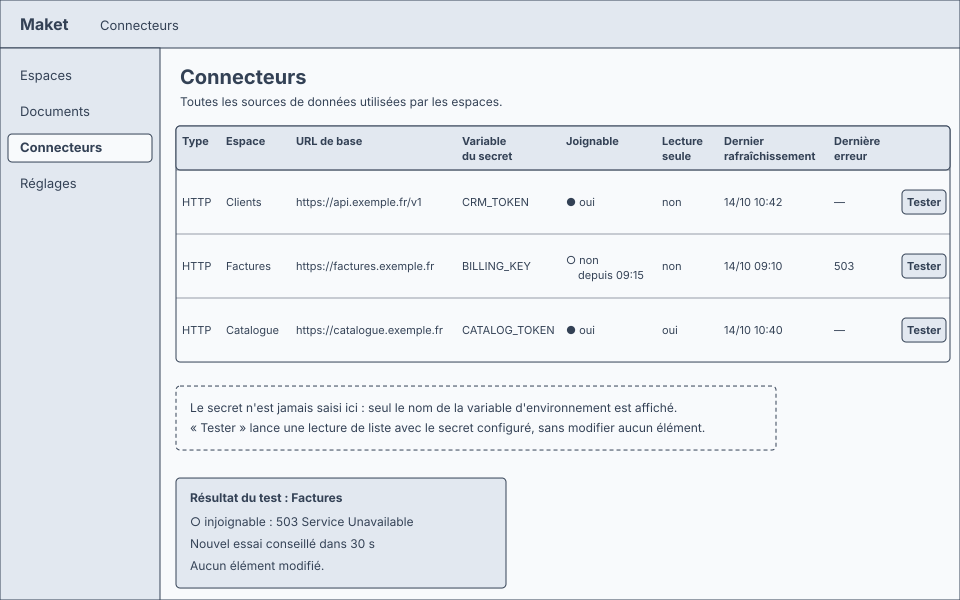
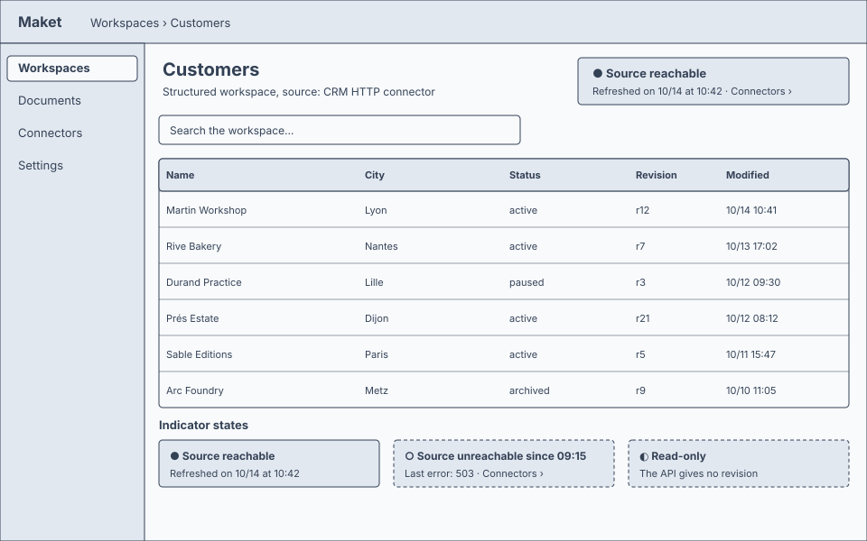

<!-- source: "/requirements" template: "templates/requirements.hbs" -->

<!-- nav -->
[Toutes les fonctionnalités](../../README.md) › [FEAT-001 · Connecteur HTTP pour les espaces structurés de Maket](index.md) › Exigences

[Index](index.md) · [Cadrage](cadrage.md) · **Exigences** · Acceptation · Ancrage · Vérification · Décisions

---
<!-- /nav -->

# Exigences : Connecteur HTTP pour les espaces structurés de Maket

Chaque exigence est une phrase EARS qui décrit une réponse observable du système. Son identifiant reste stable.

<!-- ptr: /requirements -->
| Exigence | Titre | Facette | Priorité | Forme EARS | Origine |
| --- | --- | --- | --- | --- | --- |
| [REQ-001](#req-001--interface-itemsource-sur-rest) | Interface ItemSource sur REST | intégration | MUST | permanente | ACT-02, CON-01 |
| [REQ-002](#req-002--configuration-de-lespace) | Configuration de l’espace | données | MUST | permanente | Q-02, ACT-01 |
| [REQ-003](#req-003--secret-par-variable-denvironnement) | Secret par variable d’environnement | sécurité | MUST | permanente | CON-02 |
| [REQ-004](#req-004--liste-par-curseur) | Liste par curseur | intégration | MUST | sur événement | ACT-02 |
| [REQ-005](#req-005--conversion-de-la-pagination) | Conversion de la pagination | intégration | MUST | sur événement | Q-04 |
| [REQ-006](#req-006--lecture-dun-%C3%A9l%C3%A9ment) | Lecture d’un élément | intégration | MUST | sur événement | ACT-02 |
| [REQ-007](#req-007--%C3%A9criture-avec-if-match) | Écriture avec If-Match | intégration | MUST | sur événement | CON-03, Q-05 |
| [REQ-008](#req-008--r%C3%A9vision-p%C3%A9rim%C3%A9e-412) | Révision périmée (412) | comportement | MUST | comportement indésirable | CON-03 |
| [REQ-009](#req-009--lecture-seule-sans-r%C3%A9vision) | Lecture seule sans révision | comportement | MUST | sur état | Q-05, CON-03 |
| [REQ-010](#req-010--cr%C3%A9ation-par-post) | Création par POST | intégration | MUST | sur événement | Q-01 |
| [REQ-011](#req-011--suppression-avec-if-match) | Suppression avec If-Match | intégration | MUST | sur événement | Q-01, CON-03 |
| [REQ-012](#req-012--interrogation-p%C3%A9riodique) | Interrogation périodique | comportement | MUST | sur état | Q-03 |
| [REQ-013](#req-013--webhook-optionnel) | Webhook optionnel | intégration | MAY | option | Q-03 |
| [REQ-014](#req-014--api-injoignable) | API injoignable | comportement | MUST | comportement indésirable | CON-04 |
| [REQ-015](#req-015--d%C3%A9lai-d%C3%A9pass%C3%A9) | Délai dépassé | comportement | MUST | sur événement | CON-04 |
| [REQ-016](#req-016--configuration-par-la-d%C3%A9finition) | Configuration par la définition | données | MUST | permanente | Q-06, ACT-02 |
| [REQ-017](#req-017--%C3%A9cran-connecteurs) | Écran Connecteurs | interface | MUST | permanente | Q-06, ACT-01 |
| [REQ-018](#req-018--test-de-connexion) | Test de connexion | comportement | MUST | sur événement | Q-06, ACT-01 |
| [REQ-019](#req-019--indicateur-d%C3%A9tat-dans-lespace) | Indicateur d'état dans l'espace | interface | MUST | permanente | Q-06, ACT-01 |
| [REQ-020](#req-020--aucune-saisie-de-secret) | Aucune saisie de secret | sécurité | MUST | comportement indésirable | CON-02, Q-06 |

<!-- id: REQ-001 -->
## REQ-001 · Interface ItemSource sur REST

The connector SHALL implement the ItemSource interface of Maket (list, get, create, put, delete, refresh) over a REST API described by the workspace configuration.

Facette : **intégration**. Forme EARS : **permanente**. Priorité : **MUST**.

Justification : Le connecteur remplace du code propre à chaque API par une configuration ; l'espace de travail ne voit que l'interface de source d'éléments existante.

Origine : ACT-02, CON-01

<!-- id: REQ-002 -->
## REQ-002 · Configuration de l’espace

The connector SHALL read the base URL, the environment variable name holding the secret, and the JSON Pointer mapping (list path, next cursor path, identity path, revision path) from the workspace configuration.

Facette : **données**. Forme EARS : **permanente**. Priorité : **MUST**.

Justification : La réponse Q-02 fixe le passage de l'API aux champs de l'élément par des pointeurs JSON, sans langage de transformation.

Origine : Q-02, ACT-01

<!-- id: REQ-003 -->
## REQ-003 · Secret par variable d’environnement

The connector SHALL send the secret read from the configured environment variable in every request, and SHALL never write the secret into the configuration or the workspace.

Facette : **sécurité**. Forme EARS : **permanente**. Priorité : **MUST**.

Justification : Aucun secret n'est écrit dans la configuration (CON-02) ; seul le nom de la variable y figure.

Origine : CON-02

<!-- id: REQ-004 -->
## REQ-004 · Liste par curseur

When the workspace asks for a batch of items, the connector SHALL call the list endpoint with the cursor and search parameters of the API and SHALL return items, the next opaque cursor and the total when the API gives one; a batch never exceeds 500 items.

Facette : **intégration**. Forme EARS : **sur événement**. Priorité : **MUST**.

Justification : La liste par curseur est le contrat de l'espace de travail ; le connecteur traduit ce contrat vers l'API.

Origine : ACT-02

<!-- id: REQ-005 -->
## REQ-005 · Conversion de la pagination

When the API paginates by page number or by a Link header, the connector SHALL convert that pagination into the opaque cursor of the workspace.

Facette : **intégration**. Forme EARS : **sur événement**. Priorité : **MUST**.

Justification : Réponse Q-04 : l'espace ne voit qu'un seul contrat, celui du curseur.

Origine : Q-04

<!-- id: REQ-006 -->
## REQ-006 · Lecture d’un élément

When the workspace asks for one item by its identity, the connector SHALL call the get endpoint and SHALL return the item data with its revision.

Facette : **intégration**. Forme EARS : **sur événement**. Priorité : **MUST**.

Justification : La lecture par identité et la révision sont nécessaires à l'ouverture et à l'écriture.

Origine : ACT-02

<!-- id: REQ-007 -->
## REQ-007 · Écriture avec If-Match

When the workspace writes an item with a known revision, the connector SHALL send PUT with the If-Match header carrying that revision.

Facette : **intégration**. Forme EARS : **sur événement**. Priorité : **MUST**.

Justification : Aucune écriture sans révision (CON-03) : la révision connue protège contre la perte de mise à jour.

Origine : CON-03, Q-05

<!-- id: REQ-008 -->
## REQ-008 · Révision périmée (412)

If the API answers 412 Precondition Failed to a write, then the connector SHALL refuse the write as a stale revision and SHALL return the current item data read again from the API.

Facette : **comportement**. Forme EARS : **comportement indésirable**. Priorité : **MUST**.

Justification : Un conflit est signalé à l'agent avec la donnée courante, jamais résolu à sa place.

Origine : CON-03

<!-- id: REQ-009 -->
## REQ-009 · Lecture seule sans révision

While the API gives neither an ETag nor a declared revision field, the connector SHALL declare the source read-only and SHALL refuse every write with the reason read_only.

Facette : **comportement**. Forme EARS : **sur état**. Priorité : **MUST**.

Justification : Réponse Q-05 : sans révision, l'écriture est refusée plutôt qu'approximative.

Origine : Q-05, CON-03

<!-- id: REQ-010 -->
## REQ-010 · Création par POST

When the workspace creates an item, the connector SHALL send POST and SHALL return the identity and revision assigned by the API.

Facette : **intégration**. Forme EARS : **sur événement**. Priorité : **MUST**.

Justification : Réponse Q-01 : la création fait partie de la première version.

Origine : Q-01

<!-- id: REQ-011 -->
## REQ-011 · Suppression avec If-Match

When the workspace deletes an item with a known revision, the connector SHALL send DELETE with the If-Match header and SHALL report 412 as a stale revision.

Facette : **intégration**. Forme EARS : **sur événement**. Priorité : **MUST**.

Justification : Réponse Q-01 : la suppression fait partie de la première version, protégée comme l'écriture.

Origine : Q-01, CON-03

<!-- id: REQ-012 -->
## REQ-012 · Interrogation périodique

While a polling interval is configured, the connector SHALL re-read the list at that interval and SHALL emit a source-changed signal when any item revision differs from the last read.

Facette : **comportement**. Forme EARS : **sur état**. Priorité : **MUST**.

Justification : Réponse Q-03 : l'interrogation périodique vient avant le webhook, parce qu'elle n'exige pas que Maket soit joignable.

Origine : Q-03

<!-- id: REQ-013 -->
## REQ-013 · Webhook optionnel

Where the API offers a webhook, the connector MAY accept its calls and SHALL emit the same source-changed signal as polling.

Facette : **intégration**. Forme EARS : **option**. Priorité : **MAY**.

Justification : Réponse Q-03 : le webhook vient ensuite, pour les API qui le proposent.

Origine : Q-03

<!-- id: REQ-014 -->
## REQ-014 · API injoignable

If the API is unreachable or answers with a server error, then the connector SHALL report source_unreachable with the retry delay and SHALL NOT retry silently.

Facette : **comportement**. Forme EARS : **comportement indésirable**. Priorité : **MUST**.

Justification : Aucun réessai silencieux (CON-04) : l'espace garde sa dernière fenêtre datée et l'agent sait pourquoi.

Origine : CON-04

<!-- id: REQ-015 -->
## REQ-015 · Délai dépassé

When a request to the API exceeds the configured timeout, the connector SHALL abort it and SHALL report source_unreachable with the timeout as retry delay.

Facette : **comportement**. Forme EARS : **sur événement**. Priorité : **MUST**.

Justification : Une API lente ne doit pas figer l'espace de travail ; le délai est une configuration, pas une constante.

Origine : CON-04

<!-- id: REQ-016 -->
## REQ-016 · Configuration par la définition

The connector configuration (base URL, environment variable name, JSON Pointer mapping, polling interval, timeout) SHALL be part of the workspace definition written through the structured workspace definition tool, and SHALL be validated by the same check as the rest of the definition.

Facette : **données**. Forme EARS : **permanente**. Priorité : **MUST**.

Justification : Réponse Q-06 : la configuration est une définition de l'espace, donc du ressort de l'agent, comme le schéma de données.

Origine : Q-06, ACT-02

<!-- id: REQ-017 -->
## REQ-017 · Écran Connecteurs

The Maket application SHALL show a Connectors screen listing every data source in use with its kind, the workspace using it, the base URL, the environment variable name, whether it is reachable, whether it is read-only, the last refresh date and the last error.

Facette : **interface**. Forme EARS : **permanente**. Priorité : **MUST**.

Justification : Réponse Q-06 : le propriétaire doit voir ce qui est branché et si ça marche, sans lire de JSON.

Origine : Q-06, ACT-01

<!-- id: ART-03 -->
**Écran Connecteurs** (`ART-03`, écran)

<!-- id: REQ-018 -->
## REQ-018 · Test de connexion

When the owner asks to test a connector from the Connectors screen, the connector SHALL perform one list request with the configured secret and SHALL report reachable or the error received, without changing any item.

Facette : **comportement**. Forme EARS : **sur événement**. Priorité : **MUST**.

Justification : Un retour immédiat sur la configuration, sans effet sur les données.

Origine : Q-06, ACT-01

<!-- id: REQ-019 -->
## REQ-019 · Indicateur d'état dans l'espace

The workspace index SHALL show a connector status indicator (reachable, unreachable since a date, read-only) visible without opening the Connectors screen.

Facette : **interface**. Forme EARS : **permanente**. Priorité : **MUST**.

Justification : Réponse Q-06 : l'état de la source se voit là où le propriétaire travaille.

Origine : Q-06, ACT-01

<!-- id: ART-04 -->
**Index de l’espace avec l’indicateur du connecteur** (`ART-04`, écran)

<!-- id: REQ-020 -->
## REQ-020 · Aucune saisie de secret

If any screen or tool of Maket receives a secret value for a connector, then Maket SHALL refuse it and SHALL point at the environment variable name instead.

Facette : **sécurité**. Forme EARS : **comportement indésirable**. Priorité : **MUST**.

Justification : Le secret vit dans l'environnement de la machine ; Maket n'en connaît que le nom (CON-02).

Origine : CON-02, Q-06

<!-- nav -->

---

[Toutes les fonctionnalités](../../README.md) › [FEAT-001 · Connecteur HTTP pour les espaces structurés de Maket](index.md) › Exigences

[Index](index.md) · [Cadrage](cadrage.md) · **Exigences** · Acceptation · Ancrage · Vérification · Décisions

← Précédent : [Cadrage](cadrage.md)
<!-- /nav -->
