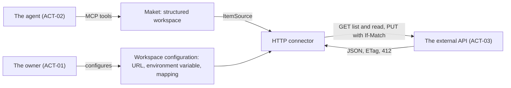
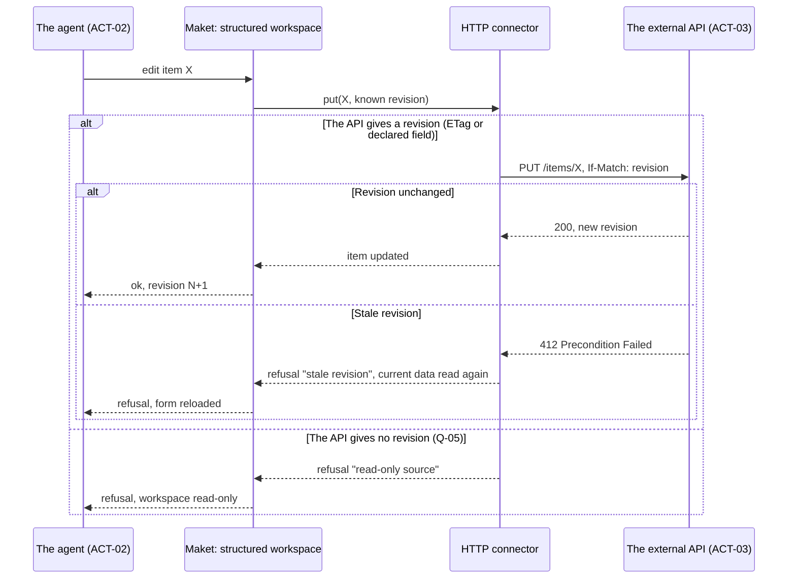

<!-- source: "/framing" template: "templates/framing.hbs" -->

<!-- nav -->
[All features](../../README.md) › [FEAT-001 · HTTP connector for Maket structured workspaces](index.md) › Framing

[Index](index.md) · **Framing** · [Requirements](requirements.md) · [Acceptance](criteria.md) · [Anchoring](anchors.md) · [Verification](verification.md) · Decisions

---
<!-- /nav -->

_Document of the closed Framing phase; the current phase is Verification: [verification.md](verification.md)._

# Framing: HTTP connector for Maket structured workspaces

<!-- ptr: /framing/intent -->
## Intent

Maket is a visual document tool for AI agents. Its structured workspaces list items that come from a data source, behind the ItemSource interface: cursor listing, search, read, create, write, delete, identity declared in the schema, revision to detect conflicts. Today, plugging in a REST API takes code written for that API. The outcome wanted: an HTTP connector that implements ItemSource on top of a REST API described by configuration, so that a workspace reads and writes the items of that API.

<!-- id: ART-01 -->
**HTTP connector context** (`ART-01`, context)

<!-- id: ART-02 -->
**Writing an item: revision, conflict and read-only** (`ART-02`, sequence)

<!-- ptr: /framing/actors -->
## Actors

<!-- id: ACT-01 -->
### The owner (`ACT-01`)

Chooses the APIs to plug in, provides the base URL and the name of the environment variable that holds the secret, reads the resulting workspaces.

<!-- id: ACT-02 -->
### The agent composing workspaces (`ACT-02`)

Declares a structured workspace plugged into the connector, then lists, searches, reads and edits the items through Maket's MCP tools.

<!-- id: ACT-03 -->
### The external API (`ACT-03`)

Third-party REST service that holds the items. It is authoritative on their content and their revision.

## Scope

<!-- ptr: /framing/scope/in -->
### In scope

<!-- ptr: /framing/scope/in/0 -->
- List items by cursor, with the API's own pagination and search parameters.
<!-- ptr: /framing/scope/in/1 -->
- Read an item by its identity.
<!-- ptr: /framing/scope/in/2 -->
- Write an item with PUT and the If-Match header carrying the known revision; a 412 answer is returned to the agent as a stale revision.
<!-- ptr: /framing/scope/in/3 -->
- Identity and revision of the items declared in the workspace schema: identity field, source of the revision (ETag or response field).
<!-- ptr: /framing/scope/in/4 -->
- Authentication by a secret read from an environment variable of which only the name appears in the configuration.
<!-- ptr: /framing/scope/in/5 -->
- Read-only workspace when the API offers no write: the connector then refuses every write.
<!-- ptr: /framing/scope/in/6 -->
- Optionally, detection of changes made outside Maket, by webhook or by periodic polling.

<!-- ptr: /framing/scope/out -->
### Out of scope

<!-- ptr: /framing/scope/out/0 -->
- Interactive OAuth authentication and token refresh.
<!-- ptr: /framing/scope/out/1 -->
- APIs that are not REST: GraphQL, SOAP, gRPC.
<!-- ptr: /framing/scope/out/2 -->
- Business transformation of the data beyond the declarative field mapping.
<!-- ptr: /framing/scope/out/3 -->
- Automatic merging of conflicts: a conflict is reported to the agent, never resolved in its place.

<!-- ptr: /framing/constraints -->
## Constraints

<!-- id: CON-01 -->
- **CON-01** · The connector implements the existing ItemSource interface without changing it.
<!-- id: CON-02 -->
- **CON-02** · No secret is written into the schema, the configuration or the documents: only the name of the environment variable.
<!-- id: CON-03 -->
- **CON-03** · A write without a known revision is refused: no blind overwrite.
<!-- id: CON-04 -->
- **CON-04** · An HTTP error is returned to the agent with its status and the API's message; a write is never retried silently.

<!-- ptr: /framing/assumptions -->
## Assumptions

<!-- id: ASM-01 -->
- **ASM-01** · The targeted APIs return JSON and expose a stable identity per item.
<!-- id: ASM-02 -->
- **ASM-02** · Maket's ItemSource interface already covers cursor, search and revision, so the connector has nothing to add to it.

<!-- ptr: /framing/questions -->
## Open questions

_No open question._

<!-- ptr: /framing/questions -->
## Answered questions

<!-- id: Q-01 -->
> [!NOTE]
> **Q-01** · Are creation (POST) and deletion (DELETE) part of the first version?
>
> Answer: Yes: creation (POST) and deletion (DELETE) are part of the first version, as recommended.
>
> _Proposed recommendation: Yes: POST with the identity returned by the API, DELETE with If-Match. They complete ItemSource and cost little once PUT is in place._
>
> Concerns: CON-01.

<!-- id: Q-02 -->
> [!NOTE]
> **Q-02** · How is the mapping from the API's JSON response to the item's fields declared?
>
> Answer: By JSON pointers declared in the workspace schema: path of the list, of the next cursor, of the identity and of the revision. No transformation language.
>
> _Proposed recommendation: By JSON pointers in the workspace schema: path of the list, of the next cursor, of the identity, of the revision. No transformation language._

<!-- id: Q-03 -->
> [!NOTE]
> **Q-03** · To follow changes made outside Maket, do we start with the webhook or with periodic polling?
>
> Answer: Periodic polling first, because it does not require Maket to be reachable from outside; the webhook comes next.
>
> _Proposed recommendation: Periodic polling first: it does not require Maket to be reachable from outside. The webhook comes next._

<!-- id: Q-04 -->
> [!NOTE]
> **Q-04** · Which forms of pagination does the connector accept: opaque cursor, page number, Link header?
>
> Answer: Opaque cursor and Link header; a page number is accepted but converted into a cursor by the connector, so that the workspace only sees the cursor contract.
>
> _Proposed recommendation: Opaque cursor and Link header. A page number is converted into a cursor by the connector._
>
> Concerns: ASM-02.

<!-- id: Q-05 -->
> [!NOTE]
> **Q-05** · If the API returns neither an ETag nor a revision field, is writing still allowed?
>
> Answer: No. A revision comes from an ETag sent back in If-Match, or from a version or date field declared as the revision by a pointer of the workspace schema. Without either, the write is refused with the reason "read-only source" and the workspace is read-only; no write by content comparison.
>
> _Proposed recommendation: No: the workspace becomes read-only._
>
> Concerns: CON-03.

<!-- id: Q-06 -->
> [!NOTE]
> **Q-06** · Where does the owner configure the connector (base URL, environment variable name, JSON pointers), and how does he see the state of the source in Maket?
>
> Answer: The configuration stays written by the agent in the workspace definition. Maket has a "Connectors" screen that lists every source in use with its kind, the workspace using it, the base URL, the environment variable name, reachable or not, read-only or not, the date of the last refresh, the last error, and a "test the connection" button. In the workspace, a connector status indicator is visible without opening the screen. No secret is entered in Maket.
>
> _Proposed recommendation: The configuration is a workspace definition, written by the agent through the MCP tool that creates or updates definitions, like the data schema. Maket shows in the workspace a read-only source panel: URL, variable name, reachable or not, read-only or not, date of the last refresh, and a "test the connection" button. No form to enter the pointers, and the secret is never entered in Maket._
>
> Concerns: ACT-01, ACT-02.

<!-- ptr: /framing/glossary -->
## Glossary

<!-- ptr: /framing/glossary/0 -->
- **item**: An entry of a structured workspace, read or written through ItemSource. Avoid: record, row.
<!-- ptr: /framing/glossary/1 -->
- **revision**: Value provided by the API that changes with every modification of an item; it is used to detect a concurrent write. Avoid: version.
<!-- ptr: /framing/glossary/2 -->
- **HTTP connector**: The ItemSource implementation that talks to a REST API described by configuration. Avoid: plugin, adapter.

<!-- nav -->

---

[All features](../../README.md) › [FEAT-001 · HTTP connector for Maket structured workspaces](index.md) › Framing

[Index](index.md) · **Framing** · [Requirements](requirements.md) · [Acceptance](criteria.md) · [Anchoring](anchors.md) · [Verification](verification.md) · Decisions

← Previous: [Index](index.md) · Next: [Requirements](requirements.md) →
<!-- /nav -->
