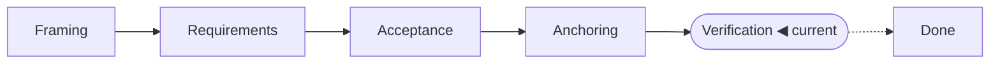

<!-- source: "" template: "templates/index.hbs" -->

<!-- nav -->
[All features](../../README.md) › FEAT-001 · HTTP connector for Maket structured workspaces

---
<!-- /nav -->

<!-- ptr: /title -->
# HTTP connector for Maket structured workspaces

Feature `FEAT-001`. Current phase: **Verification**.

> [!WARNING]
> Verification to redo: 22 test(s) failing or not yet written.

<!-- ptr: /phase -->

## Documents

- [Framing](framing.md): intent, actors, scope, constraints, assumptions, questions, glossary
- [Requirements](requirements.md): one EARS sentence per requirement, with facet and priority
- [Acceptance](criteria.md): one Given/When/Then example per criterion, grouped by requirement
- [Anchoring](anchors.md): the places in the code that realise the requirements
- [Verification](verification.md): the tests that verify the criteria, and the coverage

## Artifacts

- ART-01: HTTP connector context (context, mermaid), in [framing.md](framing.md)
- ART-02: Writing an item: revision, conflict and read-only (sequence, mermaid), in [framing.md](framing.md)
- ART-03: Connectors screen (screen, svg), in [requirements.md](requirements.md)
- ART-04: Workspace index with the connector status indicator (screen, svg), in [requirements.md](requirements.md)
- ART-05: Modules touched by the HTTP connector (modules, mermaid), in [requirements.md](requirements.md)

## Left to do in the Verification phase

- [ ] AC-001.1 · test to write
- [ ] AC-002.1 · test to write
- [ ] AC-003.1 · test to write
- [ ] AC-004.1 · test to write
- [ ] AC-004.2 · test to write
- [ ] AC-005.1 · test to write
- [ ] AC-006.1 · test to write
- [ ] AC-007.1 · test to write
- [ ] AC-008.1 · test to write
- [ ] AC-009.1 · test to write
- [ ] AC-010.1 · test to write
- [ ] AC-011.1 · test to write
- [ ] AC-012.1 · test to write
- [ ] AC-013.1 · test to write
- [ ] AC-014.1 · test to write
- [ ] AC-015.1 · test to write
- [ ] AC-016.1 · test to write
- [ ] AC-017.1 · test to write
- [ ] AC-018.1 · test to write
- [ ] AC-018.2 · test to write
- [ ] AC-019.1 · test to write
- [ ] AC-020.1 · test to write

<!-- ptr: /framing/questions -->
## Questions

- [x] Q-01 · Are creation (POST) and deletion (DELETE) part of the first version?
- [x] Q-02 · How is the mapping from the API's JSON response to the item's fields declared?
- [x] Q-03 · To follow changes made outside Maket, do we start with the webhook or with periodic polling?
- [x] Q-04 · Which forms of pagination does the connector accept: opaque cursor, page number, Link header?
- [x] Q-05 · If the API returns neither an ETag nor a revision field, is writing still allowed?
- [x] Q-06 · Where does the owner configure the connector (base URL, environment variable name, JSON pointers), and how does he see the state of the source in Maket?

<!-- ptr: /lifecycle -->
## History

- 2026-10-14: phase Framing, decided by the agent
- 2026-10-14: phase Requirements, decided by the owner
- 2026-10-14: phase Acceptance, decided by the owner
- 2026-10-14: phase Anchoring, decided by the owner
- 2026-10-14: phase Verification, decided by the owner
- 2026-10-14: phase Done, decided by the owner
- 2026-10-14: phase Verification, decided by the owner, moved back: Clôture passée à tort par l'ancienne porte : 22 tests déclarés mais manquants, le connecteur n'est pas développé.
- 2026-10-14: last reconciliation of your edits, 2 applied, 0 reported

## How to take part

Read the documents. Answer in the conversation, or edit these files directly and ask the agent to take your edits into account. The `<!-- id: … -->` and `<!-- ptr: … -->` comments mark each block: leave them in place; to add a block, copy the shape of a neighbouring one. An SVG screen is edited in its file, under `assets/`.

<!-- nav -->

---

[All features](../../README.md) › FEAT-001 · HTTP connector for Maket structured workspaces

Next: [Framing](framing.md) →
<!-- /nav -->
