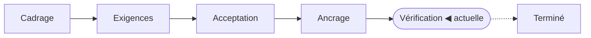

<!-- source: "" template: "templates/index.hbs" -->

<!-- nav -->
[Toutes les fonctionnalités](../../README.md) › FEAT-001 · Connecteur HTTP pour les espaces structurés de Maket

---
<!-- /nav -->

<!-- ptr: /title -->
# Connecteur HTTP pour les espaces structurés de Maket

Fonctionnalité `FEAT-001`. Phase actuelle : **Vérification**.

> [!WARNING]
> Vérification à refaire : 22 test(s) en échec ou pas encore écrit(s).

<!-- ptr: /phase -->

## Documents

- [Cadrage](cadrage.md) : intention, acteurs, périmètre, contraintes, hypothèses, questions, glossaire
- [Exigences](exigences.md) : une phrase EARS par exigence, avec sa priorité
- [Acceptation](criteres.md) : un exemple Soit/Quand/Alors par critère, groupés par exigence
- [Ancrage](ancrage.md) : les endroits du code qui réalisent les exigences
- [Vérification](verification.md) : les tests qui vérifient les critères, et la couverture

## Artefacts

- ART-01 : Contexte du connecteur HTTP (contexte, mermaid), dans [cadrage.md](cadrage.md)
- ART-02 : Écriture d'un élément : révision, conflit et lecture seule (séquence, mermaid), dans [cadrage.md](cadrage.md)
- ART-03 : Écran Connecteurs (écran, svg), dans [exigences.md](exigences.md)
- ART-04 : Index de l’espace avec l’indicateur du connecteur (écran, svg), dans [exigences.md](exigences.md)
- ART-05 : Modules touchés par le connecteur HTTP (modules, mermaid), dans [exigences.md](exigences.md)

## Reste à faire pour la phase « Vérification »

- [ ] AC-001.1 · test à écrire
- [ ] AC-002.1 · test à écrire
- [ ] AC-003.1 · test à écrire
- [ ] AC-004.1 · test à écrire
- [ ] AC-004.2 · test à écrire
- [ ] AC-005.1 · test à écrire
- [ ] AC-006.1 · test à écrire
- [ ] AC-007.1 · test à écrire
- [ ] AC-008.1 · test à écrire
- [ ] AC-009.1 · test à écrire
- [ ] AC-010.1 · test à écrire
- [ ] AC-011.1 · test à écrire
- [ ] AC-012.1 · test à écrire
- [ ] AC-013.1 · test à écrire
- [ ] AC-014.1 · test à écrire
- [ ] AC-015.1 · test à écrire
- [ ] AC-016.1 · test à écrire
- [ ] AC-017.1 · test à écrire
- [ ] AC-018.1 · test à écrire
- [ ] AC-018.2 · test à écrire
- [ ] AC-019.1 · test à écrire
- [ ] AC-020.1 · test à écrire

<!-- ptr: /framing/questions -->
## Questions

- [x] Q-01 · La création (POST) et la suppression (DELETE) font-elles partie de la première version ?
- [x] Q-02 · Comment déclare-t-on le passage de la réponse JSON de l'API aux champs de l'élément ?
- [x] Q-03 · Pour suivre les changements faits hors de Maket, commence-t-on par le webhook ou par l'interrogation périodique ?
- [x] Q-04 · Quelles formes de pagination le connecteur accepte-t-il : curseur opaque, numéro de page, en-tête Link ?
- [x] Q-05 · Si l'API ne renvoie ni ETag ni champ de révision, l'écriture reste-t-elle permise ?
- [x] Q-06 · Par où le propriétaire configure-t-il le connecteur (URL de base, nom de la variable d'environnement, pointeurs JSON) et comment voit-il l'état de la source dans Maket ?

<!-- ptr: /lifecycle -->
## Historique

- 2026-10-14 : phase « Cadrage », décidée par l'agent
- 2026-10-14 : phase « Exigences », décidée par le propriétaire
- 2026-10-14 : phase « Acceptation », décidée par le propriétaire
- 2026-10-14 : phase « Ancrage », décidée par le propriétaire
- 2026-10-14 : phase « Vérification », décidée par le propriétaire
- 2026-10-14 : phase « Terminé », décidée par le propriétaire
- 2026-10-14 : phase « Vérification », décidée par le propriétaire, retour en arrière : Clôture passée à tort par l'ancienne porte : 22 tests déclarés mais manquants, le connecteur n'est pas développé.
- 2026-10-14 : dernière réconciliation de vos modifications, 3 appliquée(s), 0 signalée(s)

## Comment intervenir

Lisez les documents. Répondez dans la conversation, ou modifiez directement ces fichiers puis demandez à l'agent de vérifier vos modifications. Les commentaires `<!-- id: … -->` et `<!-- ptr: … -->` repèrent chaque bloc : laissez-les en place ; pour ajouter un bloc, recopiez la forme d'un bloc voisin. Un écran SVG se modifie dans son fichier, sous `assets/`.

<!-- nav -->

---

[Toutes les fonctionnalités](../../README.md) › FEAT-001 · Connecteur HTTP pour les espaces structurés de Maket

Suivant : [Cadrage](cadrage.md) →
<!-- /nav -->
