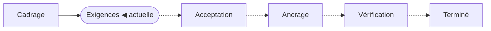

<!-- source: "" template: "templates/index.hbs" -->

<!-- ptr: /title -->
# Connecteur HTTP pour les espaces structurés de Maket

Fonctionnalité `FEAT-001`. Phase actuelle : **Exigences**.

<!-- ptr: /phase -->

## Documents

- [Cadrage](cadrage.md) : intention, acteurs, périmètre, contraintes, hypothèses, questions, glossaire
- [Exigences](exigences.md) : une phrase EARS par exigence, avec sa priorité

## Artefacts

- ART-01 : Contexte du connecteur HTTP (contexte, mermaid), dans [cadrage.md](cadrage.md)
- ART-02 : Écriture d'un élément : révision, conflit et lecture seule (séquence, mermaid), dans [cadrage.md](cadrage.md)

## Reste à faire pour la phase « Exigences »

Rien : la phase est complète. Le passage à la phase suivante se décide dans la conversation.

<!-- ptr: /lifecycle -->
## Historique

- 2026-10-14 : phase « Cadrage », décidée par l'agent
- 2026-10-14 : phase « Exigences », décidée par le propriétaire
- 2026-10-14 : dernière vérification de vos modifications, 3 appliquée(s), 0 signalée(s)

## Comment intervenir

Lisez les documents. Répondez dans la conversation, ou modifiez directement ces fichiers puis demandez à l'agent de vérifier vos modifications. Les commentaires `<!-- id: … -->` et `<!-- ptr: … -->` repèrent chaque bloc : laissez-les en place ; pour ajouter un bloc, recopiez la forme d'un bloc voisin. Un écran SVG se modifie dans son fichier, sous `assets/`.
