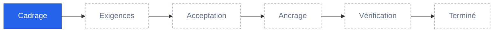

<!-- source: "" template: "templates/index.hbs" -->

<!-- ptr: /title -->
# Connecteur HTTP pour les espaces structurés de Maket

Fonctionnalité `FEAT-001`. Phase actuelle : **Cadrage**.

<!-- ptr: /phase -->

## Documents

- [Cadrage](cadrage.md) : intention, acteurs, périmètre, contraintes, hypothèses, questions, glossaire

## Artefacts

- ART-01 : Contexte du connecteur HTTP (contexte, mermaid), dans [cadrage.md](cadrage.md)

## Reste à faire pour la phase « Cadrage »

- Question Q-01 à répondre : `/framing/questions/0/status`
- Question Q-02 à répondre : `/framing/questions/1/status`
- Question Q-03 à répondre : `/framing/questions/2/status`
- Question Q-04 à répondre : `/framing/questions/3/status`
- Question Q-05 à répondre : `/framing/questions/4/status`

<!-- ptr: /lifecycle -->
## Historique

- 2026-10-14 : phase « Cadrage », décidée par l'agent

## Comment intervenir

Lisez les documents. Répondez dans la conversation, ou modifiez directement ces fichiers puis demandez à l'agent de vérifier vos modifications. Les commentaires `<!-- id: … -->` et `<!-- ptr: … -->` repèrent chaque bloc ; un schéma SVG se modifie dans son fichier sous `assets/` : laissez-les en place ; pour ajouter un bloc, recopiez la forme d'un bloc voisin.
