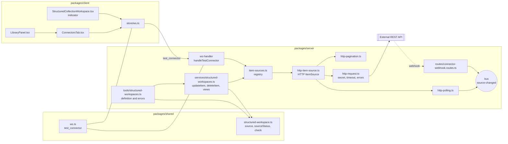

<!-- source: "/requirements" template: "templates/requirements.hbs" -->

<!-- nav -->
[All features](../../README.md) › [FEAT-001 · HTTP connector for Maket structured workspaces](index.md) › Requirements

[Index](index.md) · [Framing](framing.md) · **Requirements** · [Acceptance](criteria.md) · [Anchoring](anchors.md) · [Verification](verification.md) · Decisions

---
<!-- /nav -->

_Document of the closed Requirements phase; the current phase is Verification: [verification.md](verification.md)._

# Requirements: HTTP connector for Maket structured workspaces

Each requirement is one EARS sentence that states an observable response of the system. Its id is stable.

<!-- ptr: /requirements -->
| Requirement | Title | Facet | Priority | EARS pattern | Source |
| --- | --- | --- | --- | --- | --- |
| [REQ-001](#req-001--itemsource-over-rest) | ItemSource over REST | integration | MUST | ubiquitous | ACT-02, CON-01 |
| [REQ-002](#req-002--workspace-configuration) | Workspace configuration | data | MUST | ubiquitous | Q-02, ACT-01 |
| [REQ-003](#req-003--secret-from-an-environment-variable) | Secret from an environment variable | security | MUST | ubiquitous | CON-02 |
| [REQ-004](#req-004--cursor-listing) | Cursor listing | integration | MUST | event-driven | ACT-02 |
| [REQ-005](#req-005--pagination-conversion) | Pagination conversion | integration | MUST | event-driven | Q-04 |
| [REQ-006](#req-006--reading-an-item) | Reading an item | integration | MUST | event-driven | ACT-02 |
| [REQ-007](#req-007--write-with-if-match) | Write with If-Match | integration | MUST | event-driven | CON-03, Q-05 |
| [REQ-008](#req-008--stale-revision-412) | Stale revision (412) | behaviour | MUST | unwanted behaviour | CON-03 |
| [REQ-009](#req-009--read-only-without-revision) | Read-only without revision | behaviour | MUST | state-driven | Q-05, CON-03 |
| [REQ-010](#req-010--creation-with-post) | Creation with POST | integration | MUST | event-driven | Q-01 |
| [REQ-011](#req-011--deletion-with-if-match) | Deletion with If-Match | integration | MUST | event-driven | Q-01, CON-03 |
| [REQ-012](#req-012--periodic-polling) | Periodic polling | behaviour | MUST | state-driven | Q-03 |
| [REQ-013](#req-013--optional-webhook) | Optional webhook | integration | MAY | optional feature | Q-03 |
| [REQ-014](#req-014--unreachable-api) | Unreachable API | behaviour | MUST | unwanted behaviour | CON-04 |
| [REQ-015](#req-015--timeout-exceeded) | Timeout exceeded | behaviour | MUST | event-driven | CON-04 |
| [REQ-016](#req-016--configuration-in-the-definition) | Configuration in the definition | data | MUST | ubiquitous | Q-06, ACT-02 |
| [REQ-017](#req-017--connectors-screen) | Connectors screen | interface | MUST | ubiquitous | Q-06, ACT-01 |
| [REQ-018](#req-018--connection-test) | Connection test | behaviour | MUST | event-driven | Q-06, ACT-01 |
| [REQ-019](#req-019--status-indicator-in-the-workspace) | Status indicator in the workspace | interface | MUST | ubiquitous | Q-06, ACT-01 |
| [REQ-020](#req-020--no-secret-entry) | No secret entry | security | MUST | unwanted behaviour | CON-02, Q-06 |

<!-- id: REQ-001 -->
## REQ-001 · ItemSource over REST

The connector SHALL implement the ItemSource interface of Maket (list, get, create, put, delete, refresh) over a REST API described by the workspace configuration.

Facet: **integration**. EARS pattern: **ubiquitous**. Priority: **MUST**.

Rationale: The connector replaces code written for each API by configuration; the workspace only sees the existing item source interface.

Source: ACT-02, CON-01

<!-- id: ART-05 -->
**Modules touched by the HTTP connector** (`ART-05`, modules)

<!-- id: REQ-002 -->
## REQ-002 · Workspace configuration

The connector SHALL read the base URL, the environment variable name holding the secret, and the JSON Pointer mapping (list path, next cursor path, identity path, revision path) from the workspace configuration.

Facet: **data**. EARS pattern: **ubiquitous**. Priority: **MUST**.

Rationale: The answer to Q-02 fixes the mapping from the API to the item's fields by JSON pointers, without a transformation language.

Source: Q-02, ACT-01

<!-- id: REQ-003 -->
## REQ-003 · Secret from an environment variable

The connector SHALL send the secret read from the configured environment variable in every request, and SHALL never write the secret into the configuration or the workspace.

Facet: **security**. EARS pattern: **ubiquitous**. Priority: **MUST**.

Rationale: No secret is written into the configuration (CON-02); only the variable name appears there.

Source: CON-02

<!-- id: REQ-004 -->
## REQ-004 · Cursor listing

When the workspace asks for a batch of items, the connector SHALL call the list endpoint with the cursor and search parameters of the API and SHALL return items, the next opaque cursor and the total when the API gives one; a batch never exceeds 500 items.

Facet: **integration**. EARS pattern: **event-driven**. Priority: **MUST**.

Rationale: Cursor listing is the workspace contract; the connector translates that contract to the API.

Source: ACT-02

<!-- id: REQ-005 -->
## REQ-005 · Pagination conversion

When the API paginates by page number or by a Link header, the connector SHALL convert that pagination into the opaque cursor of the workspace.

Facet: **integration**. EARS pattern: **event-driven**. Priority: **MUST**.

Rationale: Answer to Q-04: the workspace sees a single contract, the cursor one.

Source: Q-04

<!-- id: REQ-006 -->
## REQ-006 · Reading an item

When the workspace asks for one item by its identity, the connector SHALL call the get endpoint and SHALL return the item data with its revision.

Facet: **integration**. EARS pattern: **event-driven**. Priority: **MUST**.

Rationale: Reading by identity and the revision are needed to open and to write an item.

Source: ACT-02

<!-- id: REQ-007 -->
## REQ-007 · Write with If-Match

When the workspace writes an item with a known revision, the connector SHALL send PUT with the If-Match header carrying that revision.

Facet: **integration**. EARS pattern: **event-driven**. Priority: **MUST**.

Rationale: No write without a revision (CON-03): the known revision protects against lost updates.

Source: CON-03, Q-05

<!-- id: REQ-008 -->
## REQ-008 · Stale revision (412)

If the API answers 412 Precondition Failed to a write, then the connector SHALL refuse the write as a stale revision and SHALL return the current item data read again from the API.

Facet: **behaviour**. EARS pattern: **unwanted behaviour**. Priority: **MUST**.

Rationale: A conflict is reported to the agent with the current data, never resolved in its place.

Source: CON-03

<!-- id: REQ-009 -->
## REQ-009 · Read-only without revision

While the API gives neither an ETag nor a declared revision field, the connector SHALL declare the source read-only and SHALL refuse every write with the reason read_only.

Facet: **behaviour**. EARS pattern: **state-driven**. Priority: **MUST**.

Rationale: Answer to Q-05: without a revision, the write is refused rather than approximate.

Source: Q-05, CON-03

<!-- id: REQ-010 -->
## REQ-010 · Creation with POST

When the workspace creates an item, the connector SHALL send POST and SHALL return the identity and revision assigned by the API.

Facet: **integration**. EARS pattern: **event-driven**. Priority: **MUST**.

Rationale: Answer to Q-01: creation is part of the first version.

Source: Q-01

<!-- id: REQ-011 -->
## REQ-011 · Deletion with If-Match

When the workspace deletes an item with a known revision, the connector SHALL send DELETE with the If-Match header and SHALL report 412 as a stale revision.

Facet: **integration**. EARS pattern: **event-driven**. Priority: **MUST**.

Rationale: Answer to Q-01: deletion is part of the first version, protected like writing.

Source: Q-01, CON-03

<!-- id: REQ-012 -->
## REQ-012 · Periodic polling

While a polling interval is configured, the connector SHALL re-read the list at that interval and SHALL emit a source-changed signal when any item revision differs from the last read.

Facet: **behaviour**. EARS pattern: **state-driven**. Priority: **MUST**.

Rationale: Answer to Q-03: periodic polling comes before the webhook, because it does not require Maket to be reachable.

Source: Q-03

<!-- id: REQ-013 -->
## REQ-013 · Optional webhook

Where the API offers a webhook, the connector MAY accept its calls and SHALL emit the same source-changed signal as polling.

Facet: **integration**. EARS pattern: **optional feature**. Priority: **MAY**.

Rationale: Answer to Q-03: the webhook comes next, for the APIs that offer it.

Source: Q-03

<!-- id: REQ-014 -->
## REQ-014 · Unreachable API

If the API is unreachable or answers with a server error, then the connector SHALL report source_unreachable with the retry delay and SHALL NOT retry silently.

Facet: **behaviour**. EARS pattern: **unwanted behaviour**. Priority: **MUST**.

Rationale: No silent retry (CON-04): the workspace keeps its last dated window and the agent knows why.

Source: CON-04

<!-- id: REQ-015 -->
## REQ-015 · Timeout exceeded

When a request to the API exceeds the configured timeout, the connector SHALL abort it and SHALL report source_unreachable with the timeout as retry delay.

Facet: **behaviour**. EARS pattern: **event-driven**. Priority: **MUST**.

Rationale: A slow API must not freeze the workspace; the timeout is configuration, not a constant.

Source: CON-04

<!-- id: REQ-016 -->
## REQ-016 · Configuration in the definition

The connector configuration (base URL, environment variable name, JSON Pointer mapping, polling interval, timeout) SHALL be part of the workspace definition written through the structured workspace definition tool, and SHALL be validated by the same check as the rest of the definition.

Facet: **data**. EARS pattern: **ubiquitous**. Priority: **MUST**.

Rationale: Answer to Q-06: the configuration is a workspace definition, so it is the agent's job, like the data schema.

Source: Q-06, ACT-02

<!-- id: REQ-017 -->
## REQ-017 · Connectors screen

The Maket application SHALL show a Connectors screen listing every data source in use with its kind, the workspace using it, the base URL, the environment variable name, whether it is reachable, whether it is read-only, the last refresh date and the last error.

Facet: **interface**. EARS pattern: **ubiquitous**. Priority: **MUST**.

Rationale: Answer to Q-06: the owner must see what is plugged in and whether it works, without reading JSON.

Source: Q-06, ACT-01

<!-- id: ART-03 -->
**Connectors screen** (`ART-03`, screen)

<!-- id: REQ-018 -->
## REQ-018 · Connection test

When the owner asks to test a connector from the Connectors screen, the connector SHALL perform one list request with the configured secret and SHALL report reachable or the error received, without changing any item.

Facet: **behaviour**. EARS pattern: **event-driven**. Priority: **MUST**.

Rationale: Immediate feedback on the configuration, with no effect on the data.

Source: Q-06, ACT-01

<!-- id: REQ-019 -->
## REQ-019 · Status indicator in the workspace

The workspace index SHALL show a connector status indicator (reachable, unreachable since a date, read-only) visible without opening the Connectors screen.

Facet: **interface**. EARS pattern: **ubiquitous**. Priority: **MUST**.

Rationale: Answer to Q-06: the state of the source shows where the owner works.

Source: Q-06, ACT-01

<!-- id: ART-04 -->
**Workspace index with the connector status indicator** (`ART-04`, screen)

<!-- id: REQ-020 -->
## REQ-020 · No secret entry

If any screen or tool of Maket receives a secret value for a connector, then Maket SHALL refuse it and SHALL point at the environment variable name instead.

Facet: **security**. EARS pattern: **unwanted behaviour**. Priority: **MUST**.

Rationale: The secret lives in the machine's environment; Maket only knows its name (CON-02).

Source: CON-02, Q-06

<!-- nav -->

---

[All features](../../README.md) › [FEAT-001 · HTTP connector for Maket structured workspaces](index.md) › Requirements

[Index](index.md) · [Framing](framing.md) · **Requirements** · [Acceptance](criteria.md) · [Anchoring](anchors.md) · [Verification](verification.md) · Decisions

← Previous: [Framing](framing.md) · Next: [Acceptance](criteria.md) →
<!-- /nav -->
